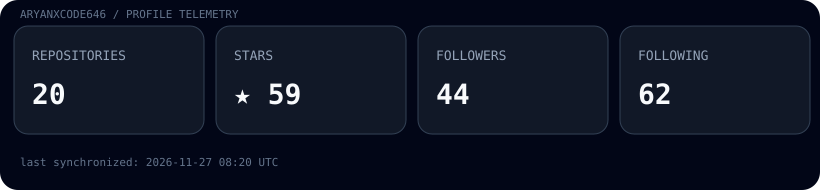

Aryan Saxena
Computer Science Undergraduate · AI/ML & Research Engineering · Open-Source Contributor

I build and maintain software at the intersection of machine learning, autonomous systems, scientific computing, and reliable engineering. I care about more than working demos: I focus on clear architecture, reproducible experiments, meaningful tests, and honest documentation of limitations.

  

Current Focus
- Machine learning: reliable data pipelines, model evaluation, and leakage-aware experiments.
- Reinforcement learning: reproducible training and evaluation, adaptive agents, and policy generalization.
- Neuromorphic computing: spiking neural networks, neuron dynamics, and plasticity mechanisms.
- Scientific computer vision: image correspondence, registration, and planetary-data workflows.
- Software engineering: developer tooling, automated testing, CI/CD, and maintainable Python systems.
Selected Projects
AdaptiveRL (ARL)
Fork of StellarResearch/ARL

A multi-environment reinforcement-learning platform for training, evaluating, and benchmarking adaptive agents with reproducible experiment protocols.
- Work: Gymnasium environments, PPO/SAC pipelines, deterministic seed schedules, JSON/CSV episode-level evaluation exports, 6-DOF quadrotor dynamics, and a Streamlit interface.
- Stack: Python, PyTorch, Gymnasium, Streamlit.
- Explore: Source · Tests
NeuroChip AR
Fork of StellarResearch/Neuro-Chip-AR

A software-first, analytically verifiable spiking neural-network prototype, built as a foundation before hardware or embedded implementation.
- Work: Leaky Integrate-and-Fire neuron dynamics, seeded Poisson rate encoding, feed-forward and delayed-feedback recurrent networks, and pair-based STDP plasticity.
- Stack: Python, NumPy.
- Explore: Source · Tests · Temporal-classification artifacts
Samanvaya
Fork of ashishsinghbora/Samanvaya

A research-oriented planetary image-registration engine for lunar optical and NIR datasets, including challenging illumination and shadow variation.
- Work: multi-modal correspondence and registration workflows, mission-data ingestion, validation hardening, and containerized execution.
- Stack: Python, OpenCV, Docker.
- Explore: Source · Tests
Q-Plastic (VQP 0.1)
Original project · MIT license

A local CPU-based ideal digital quantum simulator with cross-checked backends and reproducible experiment persistence.
- Work: one- and two-qubit gates, Qiskit Aer statevector backend with canonical big-endian bit ordering, an independent NumPy reference backend (up to 8 qubits), memory guard, Typer CLI, and atomic JSON persistence.
- Scope: VQP 0.1 is a simulator prototype. Noise models and adaptive learning are planned, not claimed as implemented.
- Stack: Python, Qiskit Aer, NumPy, Typer.
- Explore: Source · Tests · Architecture docs
DiseasePrediction
Original project · MIT license

A leakage-aware binary-classification pipeline using the UCI Breast Cancer Wisconsin (Diagnostic) dataset, with a focus on recall and false-negative analysis.
- Work: strict input validation, fold-isolated imputation and scaling, training-only out-of-fold F2 threshold selection, Brier score and calibration reporting, and a Streamlit interface.
- Stack: Python, scikit-learn, XGBoost, Pandas.
- Scope: educational benchmark; not a clinically validated diagnostic system.
- Explore: Source · Tests
CreditScoringModel
Original project · MIT license

A credit-risk classification benchmark using the UCI Statlog German Credit dataset.
- Work: stratified cross-validation, feature engineering, multi-model evaluation, and an optional Streamlit interface.
- Stack: Python, scikit-learn, Pandas, Streamlit.
- Scope: educational benchmark; not validated for real-world lending or underwriting decisions.
- Explore: Source · Tests
Browse all public repositories →
Open-Source Contributions
I contribute through implementation, issue investigation, bug reproduction, testing, documentation, and developer-experience improvements. These are selected merged pull requests:
Repository / PR	Contribution	Merged
StellarResearch/ARL #305	Centralized deterministic seed derivation across training, pre-evaluation, post-evaluation, and update phases, with pre-run validation.	2026-10-17
StellarResearch/ARL #155	Added episode-level evaluation records and optional JSON/CSV export while preserving aggregate metrics and seeding.	2026-09-27
StellarResearch/ARL #258	Improved fork usability, installation guidance, GUI workflow, and evaluation tooling.	2026-09-28
AryanXCode646/DiseasePrediction #1	Hardened input validation and added training-only OOF F2 thresholding, probability calibration, and CI.	2026-11-26

Technical Skills
Area	Tools and topics
Languages	Python, C++, JavaScript, TypeScript, Go, Kotlin
Machine learning	NumPy, Pandas, scikit-learn, PyTorch, XGBoost
AI and research	Reinforcement learning, Gymnasium, PPO/SAC, spiking neural networks, LLM integration, scientific computing
Computer vision	OpenCV, image processing, image registration, correspondence workflows
Software engineering	FastAPI, React, Node.js, Electron, Git, GitHub Actions
Infrastructure and quality	Linux, Docker, SQLite, MongoDB, automated testing (pytest, unittest), CI/CD

Engineering Principles
- Reproducibility: make seeds, configurations, dependencies, and data contracts explicit.
- Validation: test observable behavior, edge cases, and failure modes—not only whether code runs.
- Honest scope: distinguish implemented features from experiments and planned work.
- Maintainability: prefer clear interfaces, reviewable changes, useful documentation, and automated checks.
GitHub Activity
The telemetry updater is configured to refresh the sections below, but the updater code currently needs repair before automated updates can resume. Until its workflow passes, these tables are the last recorded snapshot from 2026-11-27 23:07 UTC. The updater replaces content only inside the marker pairs; keep those markers intact when editing this file.
Profile Metrics
<!-- PROFILE:START -->
Metric	Last Recorded Value
Public Repositories	25
Active Owned Repositories	14
Stars (Active Owned, excluding forks)	★ 64
Followers	44
Following	112
Latest Active Repository	CreditScoringModel
Top Languages (Active Owned)	Python (9) · JavaScript (2) · TypeScript (1)
Last Successful Sync	2026-11-27 23:07 UTC

<!-- PROFILE:END -->Recent Repository Activity
<!-- ACTIVITY:START -->
Repository	Description	Language	Stars	Last Pushed
CreditScoringModel	Machine Learning Credit Scoring Model on UCI Statlog German Credit	Python	★ 1	2026-11-27
DiseasePrediction	Disease Prediction from Medical Data (Breast Cancer Wisconsin)	Python	★ 1	2026-11-27
HandwrittenCharacterRecognition	Handwritten Digit Recognition CNN on MNIST (PyTorch)	Python	★ 1	2026-11-27
ObjectDetectionTracking	—	Python	★ 1	2026-11-27
AryanXCode646	Profile and automation repository	Python	★ 12	2026-11-27
Q-Plastic	A Quantum Computer That Learns Like a Brain	Python	★ 1	2026-11-26

Last activity snapshot: 2026-11-27 23:07 UTC. Values will refresh after the updater repair is merged and the telemetry workflow runs successfully.

<!-- ACTIVITY:END -->Automated Profile Assets
- Profile telemetry: Workflow · [Updater script](scripts/update_profile.py). The workflow is configured to check profile and repository data every six hours and update the metrics, activity table, and SVG when content changes; it must pass after the updater repair before those updates can resume.
- Contribution snake: Workflow. The scheduled workflow is configured to regenerate the contribution graphic every twelve hours and publish it to the output branch.

  <picture>
    <source media="(prefers-color-scheme: dark)" srcset="https://raw.githubusercontent.com/AryanXCode646/AryanXCode646/output/github-snake-dark.svg" />
    <source media="(prefers-color-scheme: light)" srcset="https://raw.githubusercontent.com/AryanXCode646/AryanXCode646/output/github-snake.svg" />
    
  </picture>

Contact
- GitHub: github.com/AryanXCode646
- LinkedIn: linkedin.com/in/aryan-saxena-0213363ab
- Email: rockstary867@gmail.com

  <strong>Build systems that survive contact with reality.</strong> 
  AI · Systems · Research · Open Source

