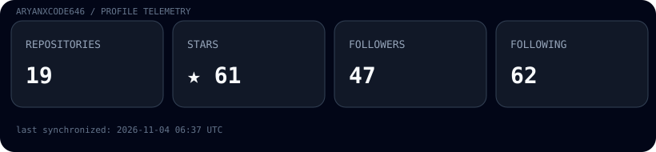

# Aryan Saxena

### Computer Science Undergraduate | AI/ML | Autonomous Systems | Computer Vision | Open Source

  
  
  

  
  
  
  
  

---

## 👋 About Me

I'm **Aryan Saxena**, a Computer Science undergraduate interested in building practical software at the intersection of **machine learning and reliable engineering**.

My work spans machine-learning experiments, reinforcement learning, computer-vision pipelines, neuromorphic computing, developer tools, and security-aware applications. I enjoy taking a project beyond the initial demo by focusing on architecture, reproducibility, meaningful tests, measurable results, and honest documentation of limitations.

- **Current interests:** AI/ML, autonomous software, scientific computer vision, and systems engineering.
- **Languages:** Python, C++, TypeScript, JavaScript, Go, and Kotlin.
- **Environment:** Linux · Manjaro KDE Plasma.
- **Engineering approach:** Build → Measure → Validate → Improve → Share.

## 🧭 Areas of Interest

<table>
  <tr>
    <td width="50%" valign="top">
      <h3>🤖 AI & Autonomous Software</h3>
      <ul>
        <li>LLM-assisted developer tools</li>
        <li>Agent workflows and tool execution</li>
        <li>Code generation and feedback loops</li>
        <li>Execution isolation and validation</li>
        <li>Local and resource-aware AI experiments</li>
      </ul>
    </td>
    <td width="50%" valign="top">
      <h3>🎯 Machine Learning & Reinforcement Learning</h3>
      <ul>
        <li>Gymnasium environments</li>
        <li>PPO-based training and evaluation</li>
        <li>Policy generalization experiments</li>
        <li>Controlled baselines and seed-based evaluation</li>
        <li>Spiking neural network fundamentals</li>
      </ul>
    </td>
  </tr>
  <tr>
    <td width="50%" valign="top">
      <h3>🌙 Computer Vision & Scientific Computing</h3>
      <ul>
        <li>Image registration and correspondence</li>
        <li>Multi-scale and illumination variation</li>
        <li>Image-processing pipelines</li>
        <li>Raster and planetary-data workflows</li>
        <li>Image stylization</li>
      </ul>
    </td>
    <td width="50%" valign="top">
      <h3>🛠️ Software & Systems Engineering</h3>
      <ul>
        <li>Python tooling and CLI applications</li>
        <li>Full-stack and desktop applications</li>
        <li>API integration and data handling</li>
        <li>Testing, CI/CD, and reproducible builds</li>
        <li>Security-aware application design</li>
      </ul>
    </td>
  </tr>
</table>

---

## 🚀 Featured Projects

A selection of projects covering my current engineering and research interests. Each repository documents its implementation status, setup, and limitations.

<table>
  <tr>
    <td width="50%" valign="top">
      <h3>🧠 <a href="https://github.com/AryanXCode646/Neuro_chip_ar">NeuroChip AR</a></h3>
      
A software-first neuromorphic computing prototype implementing leaky integrate-and-fire neurons, spike encoding, feed-forward and recurrent spiking networks, and spike-timing-dependent plasticity.

      
 

      
<a href="https://github.com/AryanXCode646/Neuro_chip_ar">Repository →</a>

    </td>
    <td width="50%" valign="top">
      <h3>🎯 <a href="https://github.com/AryanXCode646/ARL">AdaptiveRL</a></h3>
      
An educational reinforcement-learning project using PPO to train and evaluate an agent in a simulated 3D drone-navigation environment. It is a simulation, not a real-world flight controller.

      
 

      
<a href="https://github.com/AryanXCode646/ARL">Repository →</a> · <a href="https://stellarresearch.github.io/ARL/">Project showcase →</a>

    </td>
  </tr>
  <tr>
    <td width="50%" valign="top">
      <h3>🌙 <a href="https://github.com/AryanXCode646/Samanvaya">Samanvaya</a></h3>
      
A research-oriented lunar image correspondence and registration framework covering mission-product ingestion, image matching, geometric estimation, and evidence-aware evaluation. Synthetic benchmark results are not real-mission accuracy validation; independent real-image validation remains a stated limitation.

      
 

      
<a href="https://github.com/AryanXCode646/Samanvaya">Repository →</a>

    </td>
    <td width="50%" valign="top">
      <h3>⚡ <a href="https://github.com/AryanXCode646/autonomous-code-development-engine">Autonomous Code Development Engine</a></h3>
      
An LLM-assisted code-development project exploring code synthesis, static checks, isolated execution, iterative correction, and project scaffolding. See the repository for its implemented scope and constraints.

      
 

      
<a href="https://github.com/AryanXCode646/autonomous-code-development-engine">Repository →</a>

    </td>
  </tr>
  <tr>
    <td width="50%" valign="top">
      <h3>💻 <a href="https://github.com/AryanXCode646/Karyakshetra">Karyakshetra</a></h3>
      
A collaborative desktop code-editor project built around Electron, React, Node.js, and WebSocket-based collaboration, with an integrated terminal and file operations.

      
 

      
<a href="https://github.com/AryanXCode646/Karyakshetra">Repository →</a>

    </td>
    <td width="50%" valign="top">
      <h3>🩺 <a href="https://github.com/AryanXCode646/dr-ai-clone">Dr.AI</a></h3>
      
A healthcare application prototype exploring authentication, role-based access, appointment workflows, simulated telehealth, and AI-safety guardrails. It is not a clinically validated diagnostic system.

      
 

      
<a href="https://github.com/AryanXCode646/dr-ai-clone">Repository →</a>

    </td>
  </tr>
  <tr>
    <td width="50%" valign="top">
      <h3>🛡️ <a href="https://github.com/AryanXCode646/OnionScan">OnionSec</a></h3>
      
An early-stage Go security-observability tool for authorized Tor onion-service assessment, evidence correlation, scan history, and exposure monitoring. Use only on services you own or are permitted to test.

      
 

      
<a href="https://github.com/AryanXCode646/OnionScan">Repository →</a>

    </td>
    <td width="50%" valign="top">
      <h3>🎨 <a href="https://github.com/AryanXCode646/cartoon-image-generator67">Cartoonify Studio</a></h3>
      
An AI and computer-vision image-stylization application with web, desktop, and CLI workflows, combining classical image processing with neural image-generation components.

      
 

      
<a href="https://github.com/AryanXCode646/cartoon-image-generator67">Repository →</a> · <a href="https://aryanxcode646.github.io/cartoon-image-generator67/">Showcase →</a>

    </td>
  </tr>
</table>

**More projects:** [Browse all public repositories](https://github.com/AryanXCode646?tab=repositories).

---

## 🔄 Automatic Profile Updates

This profile README is connected to GitHub Actions and refreshes its live sections from the public GitHub API. You do not need to edit the follower, star, repository, language, or recent-activity values manually.

- **Profile telemetry:** The `Profile Telemetry` workflow checks GitHub profile and repository data every 6 hours. It updates the metrics table, recent repository activity, and `assets/profile-metrics.svg`, then commits changes when the generated content has changed.
- **Contribution snake:** The `Generate Snake Contribution Grid` workflow regenerates the contribution snake every 12 hours and publishes the SVG files to the `output` branch.
- **Manual refresh:** Both workflows can also be started from the repository's **Actions** tab using **Run workflow**.
- **Change detection:** A push to `main` that changes the README, telemetry script, or telemetry workflow also starts the profile telemetry workflow.

GitHub does not send a direct profile-update event to this repository when a follower, star, or public repository changes. The scheduled workflow checks for those changes, so updates normally appear on the next successful scheduled run. GitHub may delay scheduled Actions runs during periods of high load.

**Automation files:** [Profile telemetry workflow](.github/workflows/profile-telemetry.yml) · [Contribution snake workflow](.github/workflows/snake.yml) · [Telemetry updater](scripts/update_profile.py).

### 📊 Live GitHub Telemetry

The table below is maintained automatically. Keep the `PROFILE` markers unchanged so the updater can refresh the content.

<!-- PROFILE:START -->
| Metric | Current Value |
| :--- | :---: |
| **Public Repositories** | `19` |
| **Repository Stars** | `★ 58` |
| **Followers** | `48` |
| **Following** | `62` |
| **Public Gists** | `0` |
| **Latest Active Repository** | [`AryanXCode646`](https://github.com/AryanXCode646/AryanXCode646) |
| **Top Repository Languages** | `Python` (4) · `JavaScript` (1) · `TypeScript` (1) |
| **Telemetry Updated** | `2026-11-13 19:37 UTC` |
<!-- PROFILE:END -->

---

## 🐍 GitHub Contribution Snake

The contribution snake is generated by GitHub Actions and served from the `output` branch. It automatically switches to the appropriate version for light and dark themes.

<picture>
  <source media="(prefers-color-scheme: dark)" srcset="https://raw.githubusercontent.com/AryanXCode646/AryanXCode646/output/github-snake-dark.svg" />
  <source media="(prefers-color-scheme: light)" srcset="https://raw.githubusercontent.com/AryanXCode646/AryanXCode646/output/github-snake.svg" />
  
</picture>

---

## 🗂️ Recent Repository Activity

This table is regenerated automatically from your recently pushed public repositories. Keep the `ACTIVITY` markers unchanged.

<!-- ACTIVITY:START -->
| Repository | Description | Language | Stars | Last Pushed |
| :--- | :--- | :---: | :---: | :---: |
| **[AryanXCode646](https://github.com/AryanXCode646/AryanXCode646)** | — | `Python` | ★ 12 | `2026-11-13` |
| **[dr-ai-clone](https://github.com/AryanXCode646/dr-ai-clone)** | &quot;A modern, AI-powered healthcare platform built with React and TypeScript&quot; | `TypeScript` | ★ 9 | `2026-10-29` |
| **[Karyakshetra](https://github.com/AryanXCode646/Karyakshetra)** | — | `JavaScript` | ★ 13 | `2026-09-27` |
| **[autonomous-code-development-engine](https://github.com/AryanXCode646/autonomous-code-development-engine)** | — | `Python` | ★ 2 | `2026-08-29` |
| **[cartoon-image-generator67](https://github.com/AryanXCode646/cartoon-image-generator67)** | — | `Python` | ★ 9 | `2026-08-29` |
| **[7_days_cool_-projects](https://github.com/AryanXCode646/7_days_cool_-projects)** | — | `Python` | ★ 2 | `2026-08-29` |

> ⚡ Automatically synchronized from GitHub on `2026-11-13 19:37 UTC`.
<!-- ACTIVITY:END -->

---

## 🧰 Technology Stack

  
  
  
  
  
  
  
  
  
  
  
  

**Tools and platforms:** Git · Linux · Manjaro · Shell · SQLite · MongoDB · Gymnasium · Stable-Baselines3 · NumPy · Pandas · FastAPI · Electron.

---

## 📈 GitHub Analytics

These cards are provided by third-party GitHub statistics services. They may occasionally be unavailable or cached because of service limits.

<!--

  
  

-->

  

---

## 🤝 Open Source

I enjoy contributing through implementation, issue investigation, bug reproduction, code review, testing, documentation, CI/CD, and architecture discussions.

I value changes that are **reviewable, measurable, reproducible, and useful**.

## 📚 Currently Exploring

- Reliable AI evaluation and agent architectures.
- Reinforcement learning and policy generalization.
- Neuromorphic computing and spiking neural networks.
- Scientific computer vision and planetary-image workflows.
- Secure execution environments and developer infrastructure.

---

### Build systems that survive contact with reality.

AI · Systems · Research · Security · Open Source

