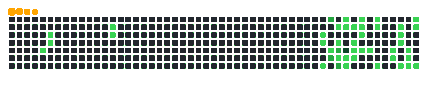

# Aryan Saxena

**Computer Science Undergraduate | AI/ML & Research Engineering | Open-Source Contributor**

I build, test, document, and maintain intelligent software systems. My work focuses on machine learning pipelines, reinforcement learning, scientific computing, and reliable developer tooling—with an emphasis on engineering correctness, reproducibility, and automated validation.

---

## Current Focus

- **Core:** Machine Learning & AI pipelines, Reinforcement Learning, and Software Engineering with CI/CD
- **Research & Specialized Domains:** Neuromorphic Computing (Spiking Neural Networks), Scientific Computer Vision, Quantum Computing Simulation, and Autonomous Developer Systems

---

## Featured Projects

### [AdaptiveRL (`ARL`)](https://github.com/AryanXCode646/ARL) · Fork of [`StellarResearch/ARL`](https://github.com/StellarResearch/ARL)
- **Problem & Solution:** Multi-environment reinforcement learning platform for training, evaluating, and benchmarking adaptive agents with reproducible experiment protocols.
- **Implemented:** Gymnasium environments, PPO/SAC training pipelines, deterministic preregistered seed schedules, JSON/CSV episode-level evaluation export, 6-DOF quadrotor dynamics, and a Streamlit interface.
- **Tech & Status:** Python, PyTorch, Gymnasium, Streamlit · Active research platform with [CI and pytest suite](https://github.com/AryanXCode646/ARL/tree/main/tests).

### [NeuroChip AR](https://github.com/AryanXCode646/Neuro_chip_ar) · Fork of [`StellarResearch/Neuro-Chip-AR`](https://github.com/StellarResearch/Neuro-Chip-AR)
- **Problem & Solution:** Establishes a pure-Python, analytically verifiable spiking neural network (SNN) substrate before any hardware or embedded implementation.
- **Implemented:** Leaky Integrate-and-Fire (LIF) neuron dynamics, seeded Poisson rate encoding, feed-forward and delayed-feedback recurrent SNNs, and pair-based STDP plasticity.
- **Tech & Status:** Python, NumPy · Experimental prototype with [unit tests](https://github.com/AryanXCode646/Neuro_chip_ar/tree/main/tests) and [temporal classification artifacts](https://github.com/AryanXCode646/Neuro_chip_ar/tree/main/artifacts).

### [Q-Plastic (VQP 0.1)](https://github.com/AryanXCode646/Q-Plastic) · Original (MIT)
- **Problem & Solution:** Provides a local CPU-based ideal digital quantum simulator with cross-checked backends and reproducible experiment persistence.
- **Implemented:** 1- and 2-qubit gate set, Qiskit Aer `statevector` backend with canonical big-endian bit ordering, independent NumPy reference backend (`<= 8` qubits), memory guard, Typer CLI, and atomic JSON persistence. *(Noise models and adaptive learning are planned for future milestones.)*
- **Tech & Status:** Python, Qiskit Aer, NumPy, Typer · VQP 0.1 prototype with [unit tests](https://github.com/AryanXCode646/Q-Plastic/tree/main/tests) and [architecture docs](https://github.com/AryanXCode646/Q-Plastic/tree/main/docs).

### [Samanvaya](https://github.com/AryanXCode646/Samanvaya) · Fork of [`ashishsinghbora/Samanvaya`](https://github.com/ashishsinghbora/Samanvaya)
- **Problem & Solution:** Planetary image registration engine designed for lunar optical and NIR datasets under extreme shadow reversals.
- **Implemented:** Multi-modal correspondence and registration workflows, mission-data ingestion, validation hardening, and containerized execution.
- **Tech & Status:** Python, OpenCV, Docker · Active research engineering with CI and [tests](https://github.com/AryanXCode646/Samanvaya/tree/main/tests).

### [DiseasePrediction](https://github.com/AryanXCode646/DiseasePrediction) · Original (MIT)
- **Problem & Solution:** Leakage-free binary classification pipeline on UCI Breast Cancer Wisconsin (Diagnostic) data prioritizing recall and false-negative analysis.
- **Implemented:** Strict input validation, fold-isolated `SimpleImputer`/`StandardScaler`, training-only out-of-fold F2 threshold selection, Brier/calibration reporting, and Streamlit UI.
- **Tech & Status:** Python, Scikit-learn, XGBoost, Pandas · Educational benchmark (not clinically validated) with CI and [pytest suite](https://github.com/AryanXCode646/DiseasePrediction/tree/main/tests).

### [CreditScoringModel](https://github.com/AryanXCode646/CreditScoringModel) · Original (MIT)
- **Problem & Solution:** Leakage-safe credit risk classification pipeline on the UCI Statlog German Credit dataset.
- **Implemented:** Stratified cross-validation, feature engineering, multi-model evaluation, and an optional Streamlit interface.
- **Tech & Status:** Python, Scikit-learn, Pandas, Streamlit · Educational benchmark (not validated for underwriting) with [pytest suite](https://github.com/AryanXCode646/CreditScoringModel/tree/main/tests).

---

## Open-Source Contributions

### External Repositories

| Repository | Pull Request | Engineering Problem & Contribution | Result |
| :--- | :--- | :--- | :--- |
| `StellarResearch/ARL` | [#305](https://github.com/StellarResearch/ARL/pull/305) | Seed schedules could overlap across phases. Centralized deterministic seed derivation across `train`, `eval_pre`, `eval_post`, and `update` domains with pre-run validation. | Merged (2026-10-17) |
| `StellarResearch/ARL` | [#155](https://github.com/StellarResearch/ARL/pull/155) | Evaluation lacked per-episode export. Added `EpisodeEvaluationRecord` and optional JSON/CSV export while preserving aggregate metrics and seeding. | Merged (2026-09-27) |
| `StellarResearch/ARL` | [#258](https://github.com/StellarResearch/ARL/pull/258) | Consolidated fork usability, installation, GUI workflow, and evaluation tooling improvements into upstream. | Merged (2026-09-28) |

### Own Repositories

| Repository | Pull Request | Engineering Problem & Contribution | Result |
| :--- | :--- | :--- | :--- |
| `AryanXCode646/DiseasePrediction` | [#1](https://github.com/AryanXCode646/DiseasePrediction/pull/1) | Hardened validation (rejecting `+/-inf`, booleans, and invalid targets), added training-only OOF F2 thresholding, probability calibration, and CI. | Merged (2026-11-26) |

---

## Technical Skills

- **Primary Languages:** Python, C++, JavaScript / TypeScript
- **Machine Learning:** NumPy, Pandas, Scikit-learn, PyTorch, OpenCV
- **AI & Research:** Reinforcement Learning (Gymnasium, PPO/SAC), Spiking Neural Networks, LLM Integration, Scientific Computing
- **Software Engineering:** FastAPI, React, Node.js, Electron, Git, GitHub Actions *(React/Electron/FastAPI used in specific full-stack and desktop projects)*
- **Infrastructure & Quality:** Linux, Docker, Automated Testing (`pytest`, `unittest`), CI/CD

---

## Engineering Principles

- **Reproducibility:** Pin seeds, configurations, dependencies, and data contracts so experiments and builds are traceable.
- **Validation:** Test observable behavior, edge cases, and failure modes rather than only checking that code runs.
- **Explicit Scope:** Distinguish implemented, experimental, and planned capabilities; never overstate prototype readiness.
- **Automation:** Turn repetitive verification, telemetry, and formatting checks into deterministic scripts and CI workflows.

---

## Development Activity

<!-- PROFILE:START -->
| Metric | Current Value |
| :--- | :---: |
| **Public Repositories** | `25` |
| **Active Owned Repositories** | `14` |
| **Stars (Active Owned, excl. forks)** | `★ 64` |
| **Followers** | `44` |
| **Following** | `112` |
| **Latest Active Repository** | [`CreditScoringModel`](https://github.com/AryanXCode646/CreditScoringModel) |
| **Top Languages (Active Owned)** | `Python` (9) · `JavaScript` (2) · `TypeScript` (1) |
| **Telemetry Updated** | `2026-11-27 23:07 UTC` |
<!-- PROFILE:END -->

<!-- ACTIVITY:START -->
| Repository | Description | Language | Stars | Last Pushed |
| :--- | :--- | :---: | :---: | :---: |
| **[CreditScoringModel](https://github.com/AryanXCode646/CreditScoringModel)** | Machine Learning Credit Scoring Model on UCI Statlog German Credit | `Python` | ★ 1 | `2026-11-27` |
| **[DiseasePrediction](https://github.com/AryanXCode646/DiseasePrediction)** | Disease Prediction from Medical Data (Breast Cancer Wisconsin) | `Python` | ★ 1 | `2026-11-27` |
| **[HandwrittenCharacterRecognition](https://github.com/AryanXCode646/HandwrittenCharacterRecognition)** | Handwritten Digit Recognition CNN on MNIST (PyTorch) | `Python` | ★ 1 | `2026-11-27` |
| **[ObjectDetectionTracking](https://github.com/AryanXCode646/ObjectDetectionTracking)** | — | `Python` | ★ 1 | `2026-11-27` |
| **[AryanXCode646](https://github.com/AryanXCode646/AryanXCode646)** | — | `Python` | ★ 12 | `2026-11-27` |
| **[Q-Plastic](https://github.com/AryanXCode646/Q-Plastic)** | A Quantum Computer That Learns Like a Brain | `Python` | ★ 1 | `2026-11-26` |

> Automatically synchronized from GitHub on `2026-11-27 23:07 UTC`.
<!-- ACTIVITY:END -->

<picture>
  <source media="(prefers-color-scheme: dark)" srcset="https://raw.githubusercontent.com/AryanXCode646/AryanXCode646/output/github-snake-dark.svg" />
  <source media="(prefers-color-scheme: light)" srcset="https://raw.githubusercontent.com/AryanXCode646/AryanXCode646/output/github-snake.svg" />
  
</picture>

---

## Contact

- **GitHub:** [github.com/AryanXCode646](https://github.com/AryanXCode646)
- **LinkedIn:** [linkedin.com/in/aryan-saxena-0213363ab](https://www.linkedin.com/in/aryan-saxena-0213363ab/)
- **Email:** [rockstary867@gmail.com](mailto:rockstary867@gmail.com)
